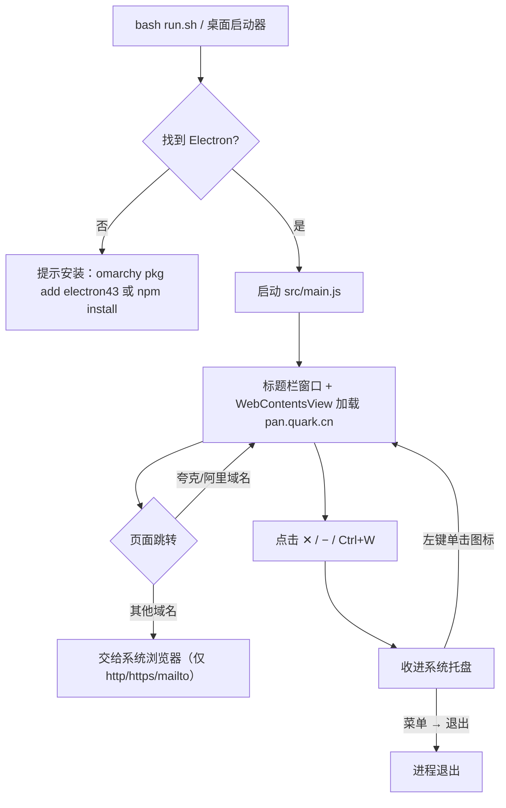
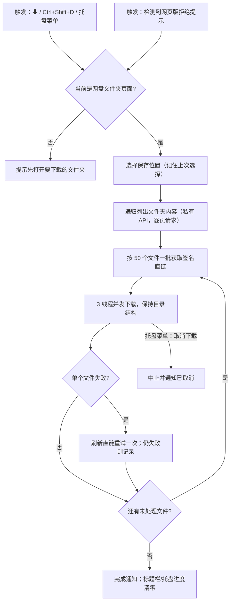
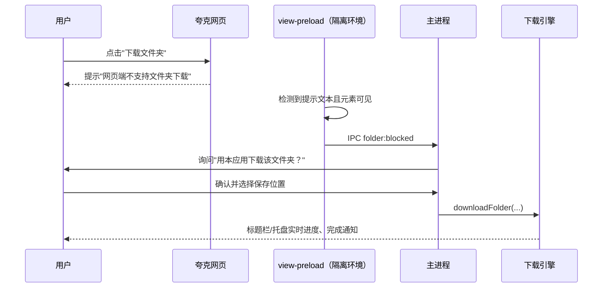

# Kuafu（夸父）— 非官方 Linux 桌面客户端（夸克网盘）

**夸父（Kuafu）**是非官方 Linux 桌面客户端（夸克网盘 / Quark Cloud）：把[网页版](https://pan.quark.cn/)包装成 Linux 原生桌面体验的 Electron 应用，补齐网页版无法完成的操作（如**文件夹下载**）。免费、开源、无遥测；与夸克官方无关。

> **⚠️ 非官方项目声明**
> 本项目是社区个人作品，**非官方**，与夸克（Quark）、UC、阿里巴巴集团及其关联公司**没有任何隶属、授权、赞助或背书关系**。
> 项目不包含官方代码或资源，不使用官方 Logo；"夸克 / Quark" 名称仅用于描述兼容对象。
> 使用须知与风险请务必阅读 **[法律与合规](#法律与合规)** 一节。

> **名字的故事 · 夸父追日**
> 夸父出自《山海经》：那位追赶太阳的巨人，明知追不到也绝不停步。
> 名字里的"夸"与"夸克"呼应（**夸**父 ← **夸**克），意象也正好——官方没做的 Linux 客户端和文件夹下载，**夸父来追**。

---

## 为什么需要它

夸克官方**没有 Linux 客户端**。直接在浏览器里使用网页版，在 Hyprland 等平铺窗口管理器下有三个痛点：

1. **没有窗口按钮**——Hyprland 不绘制服务端窗口装饰，"浏览器应用模式"窗口没有任何标题栏按钮；
2. **关闭即退出**——无法把窗口收进系统托盘继续运行；
3. **文件夹无法下载**——网页版会提示"网页端不支持文件夹下载，请使用客户端"，而客户端根本没有 Linux 版。

本项目用一个轻量 Electron 外壳解决这三点：

- **自绘标题栏**（Logo、页面标题、后退/前进、刷新、下载文件夹、最小化、关闭），不依赖合成器装饰；
- **关闭 / 最小化 = 收进系统托盘**，单击图标即可恢复；
- **文件夹下载**：直接模仿 PC 客户端的私有接口，递归下载整个文件夹并保留目录结构——这是网页版做不到的。

其他设计取舍：

| 决策 | 原因 |
|---|---|
| Electron 而非 WebKitGTK | 与网站 SPA 的 Chromium 兼容性更好；系统通常已自带 Electron |
| 独立配置目录 + Chrome UA | 网站会拒绝"未知浏览器"；登录会话与日常浏览器隔离，扫码登录可长期保持 |
| `--class=quark-cloud` | 提供稳定的窗口类名，便于窗口规则 / 任务栏识别 |
| 标题栏读取 Omarchy 主题 | 跟随当前主题颜色（每 20 秒轮询，切换主题即时生效）；主题文件不存在时使用内置配色 |
| 外链交给系统浏览器 | 仅 http/https/mailto；其余协议一律忽略 |

---

## 功能特性

- 自绘标题栏；关闭/最小化收进托盘，单击托盘图标恢复
- 单实例运行；再次启动会聚焦已有窗口
- 独立会话：扫码一次，长期有效（保存在 `~/.config/quark-cloud`）
- **文件夹下载**（见下文）：保留目录结构、标题栏与托盘实时进度、系统通知、可取消
- 网页版提示"不支持文件夹下载"时，应用会主动询问是否改用本地下载
- 权限最小化：仅剪贴板写入、通知、全屏，且仅限夸克/阿里域名
- 无遥测、无广告、不向任何第三方服务器发送数据

---

## 系统要求

| 要求 | 说明 | 安装方式 |
|---|---|---|
| Linux 桌面（任意 DE/WM） | 需要一个 **StatusNotifier 托盘**：KDE 自带；GNOME 需 AppIndicator 扩展；Waybar/Polybar 等均可 | — |
| **Electron ≥ 37** | 运行环境 | `omarchy pkg add electron43`（Arch/Omarchy）或项目内 `npm install`（需 Node.js） |
| libappindicator / libayatana-appindicator | 托盘图标（D-Bus） | Arch：`sudo pacman -S libappindicator libayatana-appindicator` |
| fcitx5（可选） | 输入中文 | Omarchy 预装；用 `pgrep fcitx5` 验证 |
| 夸克账号 + 手机夸克 App | 扫码登录 | — |

---

## 安装

```bash
# 1. 把项目放在任意目录
cd ~/Projects/kuafu

# 2. 确保有 Electron（已装 electron43 可跳过）
omarchy pkg add electron43      # 或：npm install（各发行版详见 INSTALL.md）

# 3. 注册桌面启动器与图标
bash install.sh

# 4. 启动
bash run.sh                     # 或 SUPER + SPACE 搜索 "Kuafu"
```

> **不用 Omarchy？** Debian、Ubuntu、Fedora、openSUSE 与 GNOME、KDE、XFCE 等桌面的完整步骤（Node.js、国内镜像、托盘依赖）见 **[INSTALL.md](INSTALL.md)**。

首次启动时用手机夸克 App 扫码登录。会话保存在 `~/.config/quark-cloud`，重启和升级都不受影响。

`install.sh` 只做三件事：复制图标到 `~/.local/share/icons/`；写入 `~/.local/share/applications/Kuafu.desktop`（指向**本目录**的绝对路径）；刷新桌面数据库。**移动项目目录后需要重新运行。**

---

## 使用

| 操作 | 方式 |
|---|---|
| 打开 / 聚焦 | `SUPER + SPACE` → "Kuafu"；或 `~/Projects/kuafu/run.sh` |
| 刷新 | `Ctrl+R` 或 `F5` |
| 后退 / 前进 | `Alt+←` / `Alt+→`，或标题栏箭头 |
| 收进托盘 | ✕ / − 按钮，或 `Ctrl+W` |
| 从托盘恢复 | 左键单击托盘图标 |
| 托盘菜单 | 右键：显示 · 刷新 · 下载当前文件夹… · 用浏览器打开 · 退出 |
| 真正退出 | 托盘菜单 → 退出；或 `Ctrl+Q` |
| 开发者工具（调试） | `F12` |
| 下载当前文件夹 | 标题栏 ⬇ 按钮，或 `Ctrl+Shift+D` |

### 文件夹下载

网页版拒绝下载文件夹（"网页端不支持文件夹下载"），并引导你安装并不存在的 Linux 客户端。本应用取而代之：模仿 PC 客户端的私有接口，递归列出文件夹并逐一下载，完整保留目录结构。

| 操作 | 方式 |
|---|---|
| 下载当前打开的文件夹 | 标题栏 ⬇、`Ctrl+Shift+D`，或托盘菜单 → 下载当前文件夹… |
| 网页提示弹出后 | 应用检测到该提示会主动询问，确认即可 |

目标目录选择一次后会被记住。进度显示在标题栏与托盘提示中，完成后有系统通知，托盘菜单可以取消。

**限制：**

- 仅支持**自己的网盘**（分享页面不支持）；
- 根目录（`fid=0`）不属于任何文件夹，会提示先打开目标文件夹；
- 不做断点续传，同名文件**直接覆盖**；
- 请求过于频繁会触发风控（错误码 `23018`）：等几分钟再试即可，不会重复下载；
- 下载直链为签名链接、会过期：程序按 50 个一批获取，单个文件失败时自动刷新一次。

### 系统托盘

托盘图标固定在 Omarchy 的 `omarchy.tray`（id 为 `quark-cloud_status_icon_1`）：左键显示/隐藏，右键弹出菜单。取消固定：右键托盘抽屉箭头 `‹` → Tray icons → Unpin。

### 可选快捷键（Hyprland）

`SUPER + SHIFT + Q` 在 Omarchy 上未被占用，可用于打开/聚焦：

```lua
-- ~/.config/hypr/bindings.lua
o.bind("SUPER + SHIFT + Q", "Kuafu", o.launch_sole("quark-cloud", os.getenv("HOME") .. "/Projects/kuafu/run.sh"))
```

### 窗口规则（Hyprland）

窗口类名固定为 `quark-cloud`，例如固定到某个工作区：

```lua
o.window("quark-cloud", { workspace = "special:quark" })  -- 示例
```

---

## 工作流程

### 启动与窗口



### 文件夹下载



### 网页拒绝提示的自动接应



---

## 安全说明

- **独立配置目录：**所有数据位于 `~/.config/quark-cloud`，与日常浏览器隔离；`bash uninstall.sh --purge` 会彻底删除（不残留 `~/.cache`）。无遥测；联网对象仅为夸克自有域名（pan.quark.cn、drive-pc.quark.cn 及下载 CDN）。
- **渲染器加固：**标题栏与网站内容都运行在沙箱 + 上下文隔离中，无 Node.js 集成。仅夸克/阿里域名留在应用内；其余链接交给系统浏览器，且只允许 `http` / `https` / `mailto` 协议。标题栏页面不允许跳转或打开新窗口。
- **权限最小化：**仅剪贴板写入、通知、全屏，且仅限夸克域名；摄像头、麦克风与静默读取剪贴板一律拒绝。
- **已知限制——磁盘上的 Cookie 未加密：**Electron 的 Linux 构建未链接系统密钥环（libsecret），因此 `~/.config/quark-cloud/Cookies` 中的会话 Cookie 以明文保存（这是所有 Linux Electron 应用的共性问题，运行 gnome-keyring 也无法改变）。请把该目录视同你的夸克密码：**不要同步、不要备份**。
- **下载防劫持：**文件名会做安全清洗；目标路径若被放置符号链接（symlink），程序**拒绝写入**而不是跟随（`O_NOFOLLOW`）。

---

## 法律与合规

> 以下内容用于降低项目与作者的法律风险，**不构成法律意见**；公开发布或任何商业化之前，请咨询专业律师，并遵守你所在司法辖区的法律。

1. **非官方声明（最重要）**——本项目为个人/社区的**非官方**项目，与夸克（Quark）、UC、阿里巴巴集团及其关联公司**无任何隶属、合作、赞助或背书关系**。项目名称中的"Quark"仅用于说明兼容对象（描述性使用）；请勿在任何场合将本项目称为官方客户端。
2. **商标与素材**——"夸克 / Quark"及相关名称、标识归其权利人所有。本项目**不使用官方 Logo、官方图片或官方界面素材**（应用图标为自制），也不包含官方客户端的代码或二进制文件。
3. **私有接口**——文件夹下载功能通过模仿官方 PC 客户端的网络请求实现，使用的是**未公开接口**，存在随时失效、触发风控或与服务条款冲突的可能。该功能仅用于下载**本人账号中的文件**，不提供任何破解、绕过分享限制或批量抓取能力；使用者需自行评估并承担相关风险。
4. **免费、无广告、无遥测**——项目不收费、不含广告、不收集任何用户数据，仅与本机登录的夸克服务通信，无任何商业竞争目的。
5. **免责与配合**——软件按 MIT 协议"按现状"提供，不提供任何明示或暗示担保；作者不对数据丢失、账号风险或间接损失承担责任。**若权利人对本项目提出合理异议，维护者承诺立即配合修改或下架相关内容。**
6. **发布建议**——在仓库描述、README 顶部与发布说明中保留"非官方"字样；不要在任何应用商店以官方名义发布；保留本节全文。

---

## 导出到其他电脑

```bash
bash package.sh          # → dist/Kuafu-1.2.1.tar.gz
```

目标电脑解压后运行 `bash install.sh` 即可；唯一的外部依赖是 Electron（见[系统要求](#系统要求)）。每台电脑需各自扫码登录，归档中**不包含任何账号数据**。

---

## 卸载

```bash
bash uninstall.sh            # 移除启动器与图标，保留登录会话
bash uninstall.sh --purge    # 同时删除 Cookie / 设置（~/.config/quark-cloud）
```

---

## 项目结构

```
kuafu/
├── README.md           # 用户文档（中文）
├── INSTALL.md          # 各发行版安装教程（非 Omarchy 用户看这个）
├── run.sh              # 启动器：自动寻找 Electron（系统或项目内）
├── install.sh          # 注册启动器 + 图标（指向本目录）
├── uninstall.sh        # 卸载（--purge 同时删除应用数据）
├── package.sh          # 打包为 dist/Kuafu-<版本>.tar.gz
├── assets/             # 应用图标（256px）与托盘图标（64px）
└── src/
    ├── main.js         # 主进程：窗口、托盘、主题、下载、单实例
    ├── quark-download.js  # 文件夹下载引擎（夸克私有 PC 接口）
    ├── preload.js      # 标题栏用的 contextBridge 桥
    ├── view-preload.js # 检测网页版"不支持文件夹下载"提示
    └── titlebar/       # 标题栏界面（HTML/CSS/JS）
```

运行数据（设置、Cookie、缓存）全部保存在 `~/.config/quark-cloud/`，项目目录保持干净、可随时打包。

---

## 常见问题

| 现象 | 原因 / 处理 |
|---|---|
| `Error: Electron not found` | 安装 Electron：`omarchy pkg add electron43`，或在项目内 `npm install` |
| 窗口没有关闭/最小化按钮 | 标题栏由应用自绘；若窗口空白，用终端运行 `bash run.sh` 查看报错 |
| 关闭窗口后应用却退出了 | 一定绕过了启动器（如用浏览器直接打开）；请始终通过 `run.sh` / 桌面图标启动 |
| 托盘里找不到图标 | 未固定的图标在托盘抽屉（箭头 `‹`）里：右键抽屉 → Tray icons → Pin `quark-cloud_status_icon_1` |
| 无法输入中文 | `run.sh` 已传 `--enable-wayland-ime`；确认 fcitx5 正在运行，改完输入法设置后重启应用 |
| 更新后要重新扫码？ | 正常不会：会话在 `~/.config/quark-cloud`，只有 `--purge` 才会删除 |
| 页面空白 / 加载异常 | 按 `Ctrl+Shift+R` 强制刷新；`F12` 查看控制台报错 |
| 提示"网页端不支持文件夹下载" | 这是网站行为，不是故障：用标题栏 ⬇（`Ctrl+Shift+D`），或接受应用的弹窗 |
| 下载报"风控"（23018） | 请求过于频繁：等几分钟重试；已下载文件会被覆盖，不会重复 |
| 下载提示 "Session expired" | 登录已失效：在应用内重新扫码登录后再试 |
| 想确认是否正在下载 | 进度显示在标题栏与托盘提示中；终端运行 `bash run.sh` 可看到 `[folder]` 日志 |
| 全部重置 | `bash uninstall.sh --purge`，然后 `bash install.sh` |

---

## 许可

MIT（个人项目；夸克网盘为第三方服务，其名称与商标归其权利人所有）。详见 `LICENSE`。

本项目为**非官方**软件，与夸克官方无关——详见[法律与合规](#法律与合规)。
